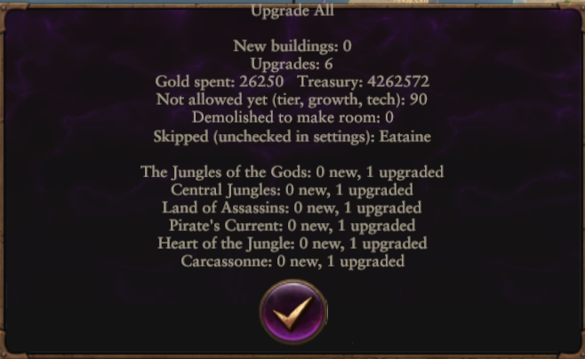
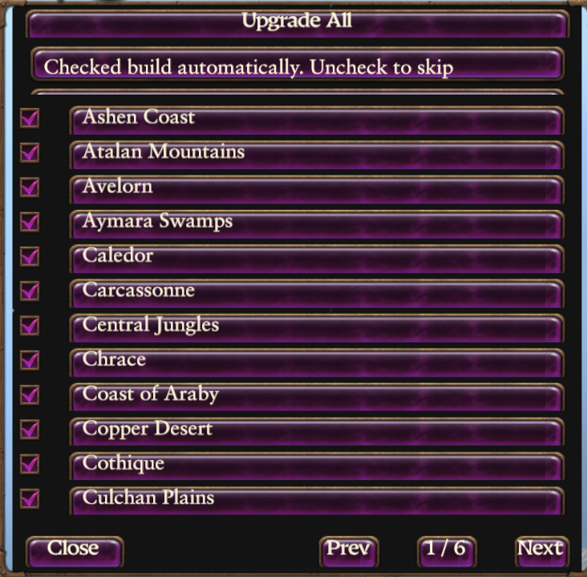

# Upgrade All

A Total War: Warhammer III campaign mod that manages your settlements' buildings
for you when you click End Turn, so you can spend your attention elsewhere.
**It works only for High Elf and Dark Elf factions, in single-player.** With any
other culture, or in a multiplayer campaign, the mod loads but does nothing
(it notes why in its trace file). Built against
Total War: Warhammer III **v9.0.5 for macOS**; other platforms should work but
haven't been tried.

When you click End Turn it spends the gold you didn't use (down to a floor) on:

1. main settlement upgrades,
2. new buildings in empty slots, following a capital or minor-settlement layout,
3. upgrades to existing buildings: income first, then growth, then the rest.

Provinces are worked in priority order: worst public order first (while it's
negative), then highest income to lowest, then provinces with no income.

At the start of your next turn a summary pops up, headed by any commandments to
set ("Set Tribute to the Phoenix King in: …" / "Set Enforce Tribute Payments in: …")
and, for High Elves, provinces where Banish Corruption is still on with nothing
left to banish.



The "UA" button in the top menu bar opens a list of your provinces; uncheck one
and the mod leaves it alone.



## What it does

- **Layouts.** High Elf capital: Homestead, Plaza, Elven Gardens, Stone Walls,
  resource building, Elven Craftsman, landmark, City Tunnels, Elven Embassy,
  Dragon's Lair. Minor: Homestead, Elven Craftsman, resource building, Watchtower,
  City Tunnels. Dark Elf equivalents: Manors, Torture Posts, Slave Pens, Slave
  Gate, resource, Artisan's House, landmark, City Tunnels, Altar of Khaine,
  Sorceress' Abode / Manors, Artisan's House, resource, Watchtowers, City Tunnels.
  Slow-build (uninhabitable climate) minors swap the industry building and City Tunnels.
- **Protected province.** High Elves: Eataine is never touched. Dark Elves: the
  lord's starting province is found on the first run and never touched.
- **Settings button.** A "UA" button next to the search button in the top menu
  bar lists your provinces; uncheck one to have the mod skip it. Saved with the campaign.
- **Demolition.** Anything that doesn't belong in a settlement's slots is
  demolished, except landmarks and special buildings, lord-specific buildings
  (Aesanar Camp, Handmaidens' Gallery, Cult of Pleasure…), the main settlement,
  ports and anything under construction. Once a province is fully grown,
  Homesteads / Manors make way for the next item.
- **Landmarks** get the last slot, in the version made for your faction or culture.
- **Crash safety.** The game crashes instead of refusing another culture's building,
  so only your own culture's buildings (culture tag as a whole word in the key)
  and landmarks vetted from the game data are ever queued.

## What it leaves to you

- Buildings with more than one upgrade path (it won't choose for you).
- The protected province (Eataine / the Dark Elf starting province).
- Aislinn's colony settlements: upgrades only, nothing new, nothing demolished.
- Commandments: the summary reminds you, but never sets them.
- Anything you build yourself during the turn: the mod only spends what's
  left when you click End Turn.

## Installing and configuring

1. Build (or download from CI) `script/campaign/mod/upgrade_all.lua`.
2. In RPFM, create or open your mod `.pack` and add the file at exactly
   `script/campaign/mod/upgrade_all.lua`.
3. Enable the `.pack` in the launcher or your mod manager, and start or load a
   single-player campaign as any High Elf or Dark Elf faction. With other
   cultures, or in multiplayer, the mod stays inactive.

Settings live in the `CONFIG` table at the top of `src/engine.lua`; change
them, rebuild, and repack. The ones you're most likely to touch:

| Setting | Default | What it does |
|---|---|---|
| `gold_floor` | `0` | Never spend the treasury below this |
| `run_at` | `"turn_end"` | `"turn_end"` builds when you click End Turn; `"turn_start"` 2 seconds into each turn |
| `allow_demolish` | `true` | Demolish buildings that don't belong in a settlement's layout |
| `popup` | `true` | Show the summary popup at the start of your turn |
| `protected_province` | `"eataine"` | High Elves: text matched against province keys; never touched |
| `landmarks` | `{}` | Region key → landmark key, to override what the data picks |
| `test_mode` | `false` | Survey settlements and build nothing (for diagnosing) |
| `detailed_trace` | `false` | Log every region, slot and commandment read (for chasing a crash) |

### Log files

Each turn the mod writes two files, overwriting `upgrade_all_summary.txt` (the
last summary) and appending to `upgrade_all_trace.txt` (step-by-step
breadcrumbs; trimmed to the last 300 lines when a campaign loads). They go in
the game's working folder and, on a Mac, also in your home folder. If the game
crashes mid-turn, the last trace line shows where.

## Repository layout

| Path | What it is |
|---|---|
| `src/engine.lua` | The mod's logic, including `CONFIG` at the top |
| `tools/data_block.lua` | Generated tables from the game data (do not edit by hand) |
| `tools/gen_data.py` | Generates `data_block.lua` from the RPFM exports |
| `exports/` | RPFM table exports the generator reads |
| `build.py` | Builds `script/campaign/mod/upgrade_all.lua` = data + engine |
| `script/campaign/mod/upgrade_all.lua` | The built mod file that goes in the `.pack` |
| `run_tests.py`, `tests/` | Test suite: a fake campaign that imitates the game's API; also fails if the built script or data block is out of date |
| `tools/mutate.py` | Mutation checks: breaks each rule in turn and confirms a test catches it |
| `.github/workflows/ci.yml` | CI: builds, checks the built file is committed, runs the tests; mutation checks weekly or on demand |
| `docs/` | Screenshots used in this README |
| `LICENSE` | GPLv2 |

## Building, testing, packaging

Requires Python 3 (CI uses 3.12) and `lupa`, which provides Lua 5.1 — the same
Lua version the game uses. Set up a virtual environment once, from the
repository root:

```sh
python3 -m venv .venv
source .venv/bin/activate          # each new shell; `deactivate` to leave
pip install -r requirements.txt
```

(Or skip activating and run `.venv/bin/python` in place of `python3` below.
`.venv/` is ignored by git.)

```sh
python3 build.py          # build script/campaign/mod/upgrade_all.lua
python3 run_tests.py      # run the test suite
python3 tools/mutate.py   # optional: confirm every safeguard is tested (a few minutes)
```

Then, in RPFM, put `script/campaign/mod/upgrade_all.lua` into your mod `.pack`
at the same path. (The CI run on GitHub also uploads that file as an artifact
named `upgrade_all.lua`.)

Edit `src/engine.lua`, never the built file: `run_tests.py` fails if the built
script doesn't match `tools/data_block.lua` + `src/engine.lua`.

## After a game patch

The data in `exports/` is from v9.0.5. After a patch:

1. In RPFM, regenerate the dependencies cache and export the tables listed at the
   top of `tools/gen_data.py` into `exports/`.
2. `python3 -I tools/gen_data.py exports tools/data_block.lua`
3. `python3 build.py && python3 run_tests.py`
4. Update the version noted at the top of this README.

## Lessons from the real game (enforced by the tests)

- `string.find` misbehaved in-game: the mod never calls it or the other pattern
  functions (`match`, `gsub`, `gmatch`).
- Queueing another culture's building crashes the game.
- No slot reads or construction inside the turn-start event; the popup there only
  reads main settlement slots and commandments.
- A timer started from inside another timer never fires.
- UI: no `LockPriority` / `RegisterTopMost`, never reuse a dying component's name.

## How this was made

All of the code here — the mod, the data generator, the test harness and the
mutation checks — was written by AI (Claude, directed by Ryan Ware) and tested
in real campaigns; the "lessons" above and the place names in the tests all
come from things that went wrong in-game. The game data in `exports/` is the
output of RPFM, unmodified. Bugs are still ours: if the mod does something
wrong, open an issue with `upgrade_all_trace.txt` and `upgrade_all_summary.txt`
attached.

This is an unofficial fan project and is not affiliated with Creative Assembly,
SEGA or Games Workshop.

## Contributing

Upgrade All was built for one person's way of playing: High Elves and Dark
Elves, a fixed layout per settlement type, income before everything else, and
a treasury spent down to zero each turn. Those choices are baked into the
`CULTURE_RULES` table and the priority order in `run_turn`, not because they
are the right ones but because they're the ones its author wanted.

Pull requests that add functionality are welcome from anyone: other cultures,
different layouts, alternative spending strategies, options for things that
are hard-coded now. The bar for merging is the same one the existing code
clears:

- `python3 run_tests.py` passes, including the generated-file checks.
- New behaviour comes with tests in `tests/test_upgrade_all.lua`; new
  safeguards get an entry in `tools/mutate.py` so it's proven a test catches
  their removal.
- No Lua pattern functions (`string.find`, `match`, `gsub`, `gmatch`), no slot
  reads inside the turn-start event, no timers inside timers, and only the
  player's own culture's buildings reach the queue. The harness fails tests
  that break these; see "Lessons from the real game" for why.
- Another culture needs its layouts and the tags in `OUR_TAGS` in
  `tools/gen_data.py`, and it needs to have been run in a real campaign of
  that culture at least once, since the crash-on-wrong-building behaviour
  can't be tested outside the game.

If you're unsure whether something fits, open an issue first.

## License

GPL version 2 only (not "or any later version"); see [LICENSE](LICENSE). The RPFM table exports in `exports/` are game
data belonging to Creative Assembly and are included only so the generator can
be re-run.
